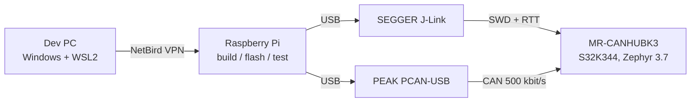

# CANHUB Telemetry: Zephyr CAN node with a remote hardware-in-the-loop lab

A Zephyr RTOS application for the NXP MR-CANHUBK3 (S32K344) that acts as a CAN node: periodic
heartbeat, command/ACK handling, bus-state monitoring, and RTT logging. It is built, flashed and
tested on real hardware through a Raspberry Pi bench reachable over a VPN.

## Architecture

## CAN protocol

| ID | Dir | Payload |
|----|-----|---------|
| 0x100 | node → bus, every 500 ms | `uptime_ms` u32, `counter` u16, `can_state` u8, `led_state` u8 (little endian) |
| 0x200 | bus → node | `op` u8 (1 set LED, 2 toggle, 3 ping), `arg0` u8 |
| 0x201 | node → bus | `op` u8, `result` u8 (0 = OK, 0xFF = unknown op) |

## Quick start
(build, flash, run tests: commands from this project)

## Tests
(paste the real `test_node.py` output, e.g. `8/8 passed`)

## Lessons learned
- S32K344 has no `HAS_SEGGER_RTT` in Zephyr 3.7, so RTT needs it declared in the app Kconfig.
- The J-Link RTT server accepts one client at a time.

## Roadmap
(DBC, UDS over ISO-TP, bus statistics, CI)

## License
MIT
