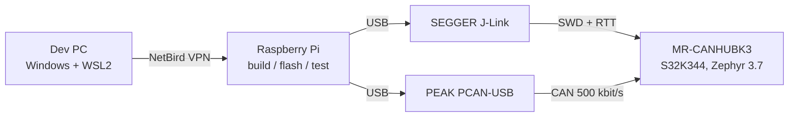

# CANHUB Telemetry: Zephyr CAN node with a remote hardware-in-the-loop lab

A Zephyr RTOS application for the NXP MR-CANHUBK3 (S32K344) that acts as a CAN node: periodic
heartbeat, command/ACK handling, bus-state monitoring, and RTT logging. It is built, flashed and
tested on real hardware through a Raspberry Pi bench reachable over a VPN.


# Hardware Architecture



This project uses four main hardware components to develop, program, debug, and test CAN communication on the NXP MR-CANHUBK3 evaluation board.

### 1. Raspberry Pi – Remote Gateway and Debug Host

The Raspberry Pi acts as the remote hardware gateway between the development environment and the embedded target.
It provides a Linux-based environment for running SEGGER J-Link debugging services and exposing the target's debugging interface over the network.

**Main responsibilities:**
- Hosts the SEGGER J-Link GDB Server.
- Provides remote access to the target through the J-Link debugger.
- Handles SWD debugging and firmware programming requests from the development host.
- Provides access to the target's SEGGER RTT output over the network.
- Uses NetBird VPN to establish secure connectivity with the Windows/WSL2 development environment.

**Role in the project:**
The Raspberry Pi allows firmware development, flashing, and debugging without requiring the developer's computer to be physically connected to the target board.

### 2. NXP MR-CANHUBK3 – Embedded Target Board
The NXP MR-CANHUBK3 is the main embedded hardware platform used for developing and testing CAN communication and telemetry applications.
It is based on the NXP S32K344 automotive microcontroller, featuring an Arm Cortex-M7 processor with lockstep architecture.
The board is designed for mobile robotics and automotive applications, providing multiple CAN FD interfaces and automotive Ethernet connectivity.

**Main hardware features:**
- NXP S32K344 automotive microcontroller.
- Six CAN FD interfaces (CAN0–CAN5).
- Multiple CAN transceiver technologies, including standard CAN FD, CAN FD with Signal Improvement Capability (SIC), and Secure CAN.
- 100BASE-T1 automotive Ethernet interface.
- UART, SPI, I2C, GPIO, and PWM interfaces.
- Onboard RGB LED and other development peripherals.
- External SWD/JTAG debugging connectors.

**Main responsibilities:**
- Runs the embedded application developed using Zephyr RTOS.
- Implements CAN frame transmission and reception.
- Processes and interprets incoming CAN messages.
- Generates telemetry and diagnostic information.
- Provides application-level status through SEGGER RTT.
- Supports testing of multiple CAN communication interfaces.

**Role in the project:**
The MR-CANHUBK3 is the central embedded target. All CAN communication logic, firmware functionality, and application-level processing are executed on this board.

### 3. SEGGER J-Link – Hardware Debugger and Programmer
SEGGER J-Link is the hardware debugging and programming interface used to communicate with the S32K344 microcontroller.
It provides access to the target through the Serial Wire Debug (SWD) interface and is connected to the Raspberry Pi, which hosts the J-Link GDB Server.

**Main responsibilities:**
- Programs firmware into the target microcontroller's flash memory.
- Provides hardware debugging through SWD.
- Supports breakpoints, stepping, register inspection, and memory inspection.
- Enables remote debugging through the J-Link GDB Server.
- Provides SEGGER Real-Time Transfer (RTT) for application diagnostics and telemetry.

**Role in the project:**
J-Link provides the low-level hardware interface required to program and debug the MR-CANHUBK3. By hosting the J-Link GDB Server on the Raspberry Pi, the debugger can be accessed remotely from the development environment.
RTT also provides a communication channel for application logs and diagnostic messages without requiring a dedicated UART console connection.

### 4. PEAK-System PCAN – CAN Bus Interface and Analyzer
The PEAK-System PCAN interface provides the connection between the development computer and the physical CAN bus.
It allows the developer to monitor, transmit, and analyze CAN messages exchanged between the MR-CANHUBK3 and other CAN nodes.
The PCAN hardware connects to the development computer through USB and interfaces with the physical CAN network through its CAN connector.

**Main responsibilities:**
- Monitors CAN bus traffic in real time.
- Transmits CAN frames to the MR-CANHUBK3.
- Receives and displays CAN frames transmitted by the target.
- Supports testing of standard CAN and, depending on the PCAN model, CAN FD communication.
- Enables CAN protocol validation and troubleshooting.
- Supports automated testing through PEAK-System PCAN-Basic APIs and compatible software tools.

**Role in the project:**
PCAN acts as the external CAN communication and testing interface. It allows the developer to interact with the physical CAN network independently of the J-Link debugging connection.
It is particularly useful for validating CAN identifiers, payloads, transmission timing, reception filters, and communication reliability.


## CAN protocol

| ID | Dir | Payload |
|----|-----|---------|
| 0x100 | node → bus, every 500 ms | `uptime_ms` u32, `counter` u16, `can_state` u8, `led_state` u8 (little endian) |
| 0x200 | bus → node | `op` u8 (1 set LED, 2 toggle, 3 ping), `arg0` u8 |
| 0x201 | node → bus | `op` u8, `result` u8 (0 = OK, 0xFF = unknown op) |

## Quick start

### Prerequisites
- Zephyr v3.7.0 workspace in `~/zephyrproject` with its Python venv (`~/zephyrproject/.venv`)
  and Zephyr SDK 0.16.8 (`arm-zephyr-eabi` toolchain)
- SEGGER J-Link software (tested with V9.96), probe connected to the board's SWD header
- PEAK PCAN-USB connected to the board's CAN connector (SocketCAN interface `can0`)
- Board powered separately

### Clone
```bash
git clone git@github.com:BenjaminS95/friendly-neighbourhood-zephyr.git
cd friendly-neighbourhood-zephyr
```

### Build and flash
```bash
tools/zflash.sh firmware
```
This stops any running J-Link GDB server, builds `firmware/` for `mr_canhubk3`, flashes it
through the J-Link, and restarts the GDB server (RTT on port 19021).

Build only, without flashing:
```bash
source ~/zephyrproject/.venv/bin/activate
source ~/zephyrproject/zephyr/zephyr-env.sh
cd ~/zephyrproject
west build -p always -b mr_canhubk3 /path/to/repo/firmware
```

### Log output (RTT)
```bash
tools/attach.sh             # attach GDB, set the RTT address, reset and run (keep this terminal open)
nc <pi-address> 19021       # in another terminal, or from another machine over the VPN
```
The RTT server accepts one client at a time.

### Bring up the CAN interface
```bash
sudo ip link set can0 up type can bitrate 500000
```

### Run the tests
```bash
source ~/zephyrproject/.venv/bin/activate
pip install python-can
python3 tools/test_node.py
```
The script checks the heartbeat (`0x100`) timing and counter, then sends the LED set, toggle,
ping and unknown-op commands (`0x200`) and verifies the ACKs (`0x201`). It exits non-zero if
any check fails.

### Manual checks
```bash
candump -tA can0            # heartbeat every 500 ms
cansend can0 200#0200       # toggle the LED, expect ACK 201#0200
```

## Tests
```bash
(.venv) (base) benjamin@agreatpi:~/canhub/tools$ python3 test_node.py
[PASS] heartbeat present
[PASS] heartbeat period ~500 ms (got 500)
[PASS] counter increments
[PASS] can_state error-active
[PASS] LED set ack
[PASS] heartbeat reports LED on
[PASS] toggle ack
[PASS] heartbeat reports LED off
[PASS] ping ack
[PASS] unknown op rejected (0xFF)

10/10 passed
```

## Lessons learned
- S32K344 has no `HAS_SEGGER_RTT` in Zephyr 3.7, so RTT needs it declared in the app Kconfig.
- The J-Link RTT server accepts one client at a time.

## Roadmap

### Done
- [x] Zephyr CAN node on MR-CANHUBK3 (S32K344): periodic heartbeat, command/ACK handling, bus-state reporting
- [x] RTT logging over a remote J-Link (Raspberry Pi gateway reachable over a VPN)
- [x] Hardware-in-the-loop test script (`tools/test_node.py`) running against the real CAN bus

### Planned

**1. Hardware-in-the-loop CI**
Register the Raspberry Pi as a GitHub Actions self-hosted runner. Every push to `main` builds the
firmware, flashes the board, runs `tools/test_node.py`, and uploads the CAN trace (`candump` log)
as a build artifact. Success criterion: a green check on the repo means the firmware passed on
real hardware.

**2. DBC database (`docs/canhub.dbc`)**
Describe the three messages (heartbeat `0x100`, command `0x200`, ACK `0x201`) in a standard DBC file
and decode frames with `cantools` instead of hand-written `struct.unpack`. The same file then works
in standard tools such as SavvyCAN or Vector software, and becomes the single source of truth for the protocol.

**3. Bus statistics**
Report TX/RX frame counts, error counters, bus-off recoveries and bus load in a new periodic message,
for example on ID `0x110` (proposed). The test script checks that the counters behave sensibly.

**4. Stress and fault tests**
Flood the bus from the Pi and verify that no commands are lost and ACK latency stays bounded.
Force a bus-off condition (for example by disconnecting the transceiver or injecting errors)
and measure how long recovery takes. Results (frame loss, latency, recovery time) will be recorded here.

**5. Diagnostics: UDS over ISO-TP**
Add an ISO-TP transport (ISO 15765-2, using Zephyr's ISO-TP library) and a small UDS server
supporting the following services:

| Service | SID |
|---|---|
| DiagnosticSessionControl | 0x10 |
| ECUReset | 0x11 |
| ReadDataByIdentifier | 0x22 |
| TesterPresent | 0x3E |

Tested from the Pi with `udsoncan` or the `can-utils` ISO-TP tools.

### Ideas (not committed)
- Telemetry dashboard on the Pi, reachable over the VPN
- CAN FD, which needs hardware beyond the classic PCAN-USB (for example two board channels wired together)
- CAN bootloader / firmware update


## License
MIT
