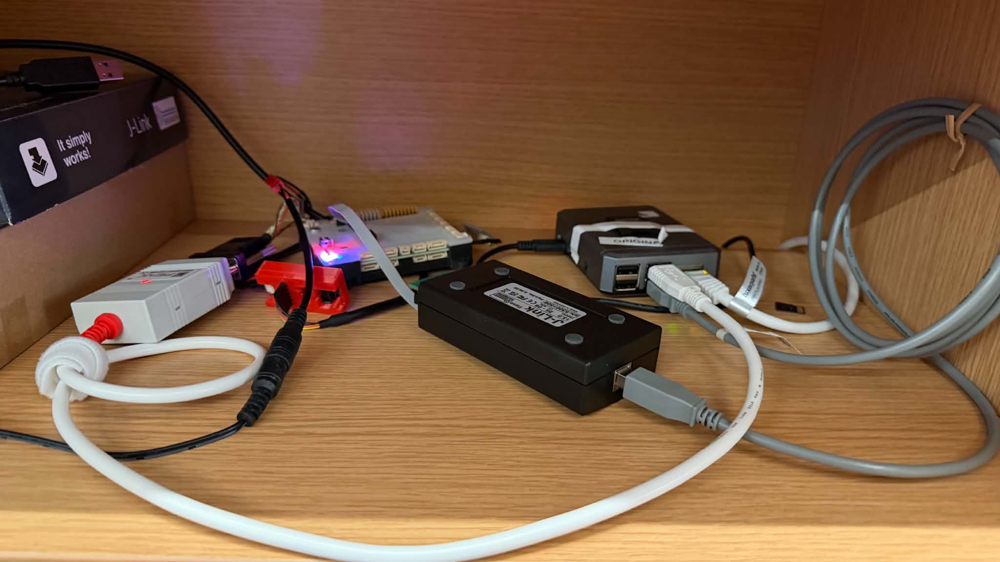
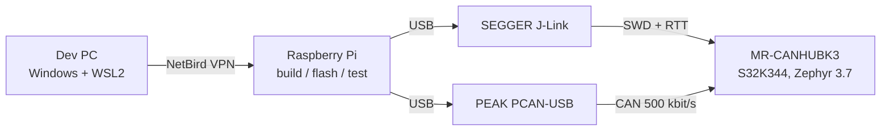

# CANHUB Telemetry: Zephyr CAN node with a remote hardware-in-the-loop lab

A Zephyr RTOS application for the NXP MR-CANHUBK3 (S32K344) that acts as a CAN node: periodic
heartbeat, command/ACK handling, bus-state monitoring, and RTT logging. It is built, flashed and
tested on real hardware through a Raspberry Pi bench reachable over a VPN.



## Architecture



## CAN protocol

| ID | Dir | Payload |
|----|-----|---------|
| 0x100 | node → bus, every 500 ms | `uptime_ms` u32, `counter` u16, `can_state` u8, `led_state` u8 (little endian) |
| 0x200 | bus → node | `op` u8 (1 set LED, 2 toggle, 3 ping), `arg0` u8 |
| 0x201 | node → bus | `op` u8, `result` u8 (0 = OK, 0xFF = unknown op) |

## Quick start

### Prerequisites
- Zephyr v3.7.0 workspace in `~/zephyrproject` with its Python venv (`~/zephyrproject/.venv`)
  and Zephyr SDK 0.16.8 (`arm-zephyr-eabi` toolchain)
- SEGGER J-Link software (tested with V9.96), probe connected to the board's SWD header
- PEAK PCAN-USB connected to the board's CAN connector (SocketCAN interface `can0`)
- Board powered separately

### Clone
```bash
git clone git@github.com:BenjaminS95/friendly-neighbourhood-zephyr.git
cd friendly-neighbourhood-zephyr
```

### Build and flash
```bash
tools/zflash.sh firmware
```
This stops any running J-Link GDB server, builds `firmware/` for `mr_canhubk3`, flashes it
through the J-Link, and restarts the GDB server (RTT on port 19021).

Build only, without flashing:
```bash
source ~/zephyrproject/.venv/bin/activate
source ~/zephyrproject/zephyr/zephyr-env.sh
cd ~/zephyrproject
west build -p always -b mr_canhubk3 /path/to/repo/firmware
```

### Log output (RTT)
```bash
tools/attach.sh             # attach GDB, set the RTT address, reset and run (keep this terminal open)
nc <pi-address> 19021       # in another terminal, or from another machine over the VPN
```
The RTT server accepts one client at a time.

### Bring up the CAN interface
```bash
sudo ip link set can0 up type can bitrate 500000
```

### Run the tests
```bash
source ~/zephyrproject/.venv/bin/activate
pip install python-can
python3 tools/test_node.py
```
The script checks the heartbeat (`0x100`) timing and counter, then sends the LED set, toggle,
ping and unknown-op commands (`0x200`) and verifies the ACKs (`0x201`). It exits non-zero if
any check fails.

### Manual checks
```bash
candump -tA can0            # heartbeat every 500 ms
cansend can0 200#0200       # toggle the LED, expect ACK 201#0200
```

## Tests
```bash
(.venv) (base) benjamin@agreatpi:~/canhub/tools$ python3 test_node.py
[PASS] heartbeat present
[PASS] heartbeat period ~500 ms (got 500)
[PASS] counter increments
[PASS] can_state error-active
[PASS] LED set ack
[PASS] heartbeat reports LED on
[PASS] toggle ack
[PASS] heartbeat reports LED off
[PASS] ping ack
[PASS] unknown op rejected (0xFF)

10/10 passed
```

## Lessons learned
- S32K344 has no `HAS_SEGGER_RTT` in Zephyr 3.7, so RTT needs it declared in the app Kconfig.
- The J-Link RTT server accepts one client at a time.

## Roadmap
(DBC, UDS over ISO-TP, bus statistics, CI)

## License
MIT
